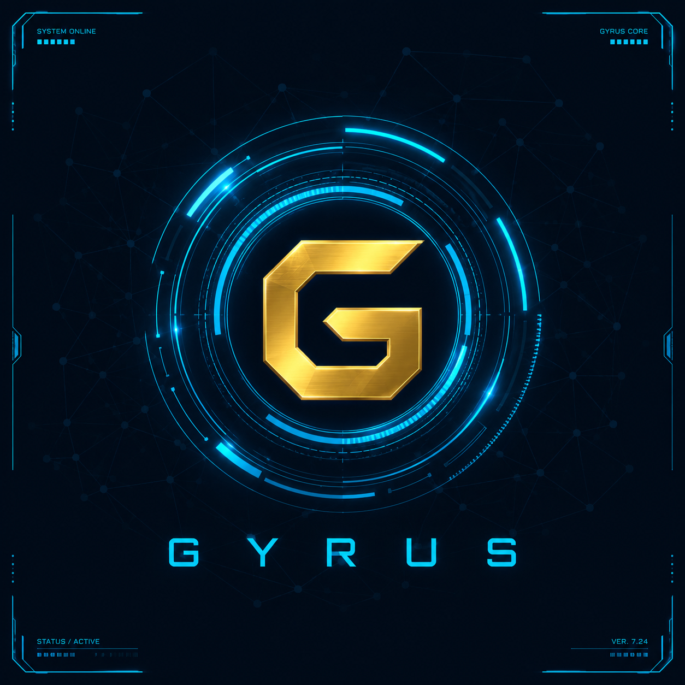

# Gyrus

A local-first personal assistant with a 3D HUD dashboard, full PC control, and persistent memory of who you are — built by **Muhammad Farhan**.



**Powered by MRS Official**
[GitHub](https://github.com/Farhanillahiclass) · [LinkedIn](https://www.linkedin.com/in/muhammadfarhanmrs)

---

## What this actually is

Gyrus is a Python backend (FastAPI) plus a browser-based 3D dashboard that together let you control your PC, manage tasks, get research/weather/news, track study and diet, message WhatsApp/email contacts, and chat — by voice or text, in Urdu or English — without any of it depending on a paid AI subscription.

Two design decisions worth knowing up front, both made deliberately rather than by default:

1. **The conversational engine runs entirely on your PC by default.** `python download_model.py` fetches a model file automatically (one command, no Hugging Face account or token needed — it's a public file download, not the API), then `local_brain.py` runs it via `llama-cpp-python`. Zero API calls, zero per-message cost, works offline once downloaded. A cloud option (`AI_PROVIDER=huggingface`) is available if you'd rather skip the download, but it depends on Hugging Face's servers being reachable — which proved unreliable enough in practice that local is the safer default.
2. **Command routing is a real, separately-trained model — not a wrapper around the chat engine.** `modules/intent_classifier.py` is a TF-IDF + Logistic Regression classifier trained on `data/intents_dataset.csv`, entirely locally, with scikit-learn. It figures out "youtube_play" vs "system_lock" vs "task_add" etc. from your phrasing, with zero API calls, and you can retrain it on more data (including a Kaggle dataset) any time with `train_model.py`. This one is genuinely trained from scratch by you — the conversational engine above is a pretrained model you run, not one you trained, and that distinction matters (see below).

---

## Fixing what broke last time

The dashboard's earlier version loaded Three.js and Google Fonts from public CDNs. In this environment, both got blocked (403), and because of how the script was structured, that one failure silently stopped *all* JavaScript on the page from running — nav clicks, forms, chat, everything. That's almost certainly what you were seeing as "overlapping / nothing works."

Fixed by:
- **Three.js is now bundled locally** (`dashboard/assets/three.min.js`) — no CDN, no network dependency, can't get blocked.
- **Fonts switched to safe system stacks** — no Google Fonts network call at all.
- **All 3D code wrapped in try/catch with fallback stubs** — even if a future WebGL issue occurs, navigation, chat, and every feature keep working; only the 3D visuals would degrade.
- **A global backend error handler** — a missing credential or missing hardware (camera, clipboard tool, etc.) now returns a clear message instead of crashing the request.

I verified this by actually rendering the dashboard in a headless browser and clicking through every page — not just checking that the code looked right.

---

## What's new in this version

**Switched the default engine back to fully local** — the Hugging Face API path proved unreliable in practice (their endpoint changed recently, and even after fixing that, depending on an external service for every single message is inherently less robust than running locally). `python download_model.py` now automates what used to be a manual browser download: one command, no account, no API key, fetches a real model file directly.

**Found and fixed a real crash bug while making this change**: `local_brain.py` imported `llama-cpp-python` at the top of the file, so if that package wasn't installed yet, chat would crash with a raw `ModuleNotFoundError` traceback instead of a helpful message. Now it's a clear, actionable error instead.

**Also fixed a rename artifact**: an earlier global find-and-replace (renaming an old internal codename to "Gyrus") had accidentally corrupted the words "millions" and "billions" inside a code comment into nonsense. Harmless to functionality, but sloppy — fixed, and checked the rest of the codebase for the same pattern.

**Fixed a real connectivity bug**: Hugging Face moved to a new unified endpoint (`router.huggingface.co`) in a recent update — the old per-model URL this project used is now broken and was causing the "connection error" some users saw even with a valid key. Updated to the current endpoint, and the token-permission instructions (needs "Make calls to Inference Providers", not "read" access).

**Home page redesigned to match a Jarvis-style reference layout**: dropped the earlier 3D robot avatar (Three.js/WebGL) entirely — it was causing real rendering glitches on some machines — in favor of a dependency-free Canvas 2D animated network orb, flanked by four live data panels: **Command Log** (real chat history with timestamps), **Engine Status** (AI provider, classifier, memory, backend — all live), **System Status** (CPU/RAM gauges + disk + pending tasks), and **CPU Activity** (a live rolling chart, not just a snapshot number). Verified by actually rendering it at three screen sizes (1440×900, 1366×768, 1280×720) with zero errors and no overlap at any of them.

**Document analyzer** — reads PDF, image, or text files and answers questions about them / summarizes them, wired into both chat commands and the Tools page.

**Dashboard redesign — 3D avatar on Home, flat professional pages everywhere else:**
- **Home** now has an actual robotic avatar (not a generic orb) — a faceted head, gold visor, antenna, and a speaker-grille mouth that animates in sync with real text-to-speech events (not a timer guess). Its eyes track your mouse cursor.
- **Every other page** (Tasks, System, Study, Communicate, Tools, Research, Detect, Settings) is now a flat, professional card-grid layout with zero 3D — exactly as requested, since 3D everywhere made the dashboard feel cluttered and slow rather than useful.
- Found and fixed a real overlap bug in the Tools page during this rebuild (three form fields crammed into one row) — verified with an actual headless-browser screenshot, not just by reading the code.

**New page: Research** — the research pipeline is real now:
- Wikipedia summary (official API) + Semantic Scholar papers (the legitimate free alternative to Google Scholar, which has no public API and blocks scraping) + a general web search, all synthesized by the AI brain into a structured article with headed sections.
- The article is saved to `data/research/<topic>-<date>.md` and the dashboard gives you a direct download link/button.
- Found a real crash bug while testing this — the Wikipedia/Semantic Scholar calls had no error handling and crashed on any network hiccup. Fixed with proper try/except so a failed lookup now degrades gracefully instead of taking down the request.

**System page**: live CPU/RAM/disk/battery stats (via psutil, tested with real numbers) alongside the existing power controls.

**Tools page upgrades**: file/folder **rename** and **move**, plus **content-based rename suggestions** — Gyrus reads a file's actual content (text directly, images via OCR) and asks the AI brain for a clearer name; it only *suggests*, you decide whether to apply it. Also added YouTube extras: playback speed, captions, theater mode.

**Study page upgrades**: weekly study-hour goals with live progress tracking, and an AI-generated quiz feature ("quiz me on X").

**Real-time reminders**: the dashboard now polls for due tasks every 15 seconds and announces them with an on-screen banner plus spoken alert, independent of whether the CLI (`main.py`) is also running.

**Persistent local memory** (`modules/user_profile.py`) — Gyrus asks your name on first run and saves it, plus anything you tell it to remember ("remember that I take sugar-free chai"), to `data/user_profile.json` on your own disk. Nothing here is cloud-synced.

**Engine**: fully local by default — `python download_model.py` fetches the model file automatically, no API key needed. Hugging Face's free API remains available as `AI_PROVIDER=huggingface` if you'd rather skip the download.

---

## Setup

```bash
git clone <this-repo> gyrus

cd gyrus
python -m venv venv && source venv/bin/activate     # Windows: venv\Scripts\activate
pip install -r requirements.txt
cp .env.example .env
python check_setup.py     # tells you exactly what's missing, before you hit a raw error
python download_model.py  # one command, downloads the local AI model — no API key needed
```

`download_model.py` fetches a ~2GB model file automatically (medium size by default; `--size small` for ~1GB/faster, `--size large` for ~5GB/better quality). This is a plain file download from Hugging Face's public storage — no account, no token, no API involved. Everything else (tasks, YouTube, system control, files, detection) works without any download or key at all.

**Windows mic:** `pip install pipwin && pipwin install pyaudio`
**llama-cpp-python fails to install:** on Windows this needs "Desktop development with C++" from [Visual Studio Build Tools](https://visualstudio.microsoft.com/visual-cpp-build-tools/); on Mac/Linux it usually just works via pip.
**Vision/OCR:** install Tesseract separately — [Windows](https://github.com/UB-Mannheim/tesseract/wiki) / `sudo apt install tesseract-ocr` / `brew install tesseract`
**Auto-login/social-post (optional):** `playwright install chromium`

---

## Running it

```bash
python check_setup.py     # always run this first after any changes

# Command line (voice or text)
python main.py
python main.py --text

# 3D Dashboard
python server.py
# then open dashboard/index.html by double-clicking it — never by typing its path into a terminal
```

---

## The dashboard — 9 pages

Only **Home** uses 3D (the robotic avatar) — every other page is a flat, professional 2D layout by design.

| Page | 3D? | What it's for |
|---|---|---|
| **Home** | ✅ avatar | Chat by voice or text; the robot's eyes follow your cursor, mouth animates when it speaks |
| **Tasks** | flat | Add/complete tasks, priority-tagged |
| **System** | flat | Lock/restart/sleep/shutdown, brightness, screenshots, live CPU/RAM/disk/battery |
| **Study & Diet** | flat | Study sessions, weekly goals, AI quiz generator, diet macro calculator |
| **Communicate** | flat | Send WhatsApp messages, read/send email |
| **Tools** | flat | Organize/rename/move files (with AI content-based rename suggestions), launch apps/websites, clipboard, OCR, YouTube playback extras |
| **Research** | flat | Deep research: Wikipedia + Semantic Scholar + web search → AI-written article → downloadable file |
| **Detect** | flat | Webcam motion + face detection |
| **Settings** | flat | Your saved profile/notes, profile analyzer, engine status, credits |

All pages talk only to `http://127.0.0.1:8765` — nothing is exposed to your network or the internet beyond the chat API call itself.

---

## Feature status

| Feature | Status |
|---|---|
| Chat (voice/text, Urdu+English) | ✅ fully local by default (`download_model.py`), Hugging Face API optional |
| Own trained intent classifier | ✅ trained locally, retrainable |
| YouTube search/play/pause/skip/volume/fullscreen | ✅ needs YouTube tab focused |
| System control (lock/restart/sleep/volume/brightness) | ✅ |
| App/website launcher, clipboard, screenshots, window management, file search | ✅ |
| File organizer | ✅ |
| Tasks with priority, reminders, overdue detection | ✅ |
| Voice-to-text notes → Word doc | ✅ |
| Weather / news / web research | ✅ no key needed |
| Vision: OCR + face detection | ✅ |
| Diet planner, study tracker | ✅ |
| Persistent local memory | ✅ new |
| Webcam motion + face detection dashboard | ✅ new |
| WhatsApp send/bulk-send/attachments | ✅ |
| WhatsApp silent auto-reply bot | ⚠️ not included — privacy for people messaging you |
| Email send/read/summarize | ✅ needs a free Gmail App Password |
| Auto-login/form filling | ✅ OS-secure-vault only, no CAPTCHA/2FA bypass |
| Social media auto-posting | ⚠️ pre-fills, you click Publish — platform ToS |
| Emotion/mood detection | ⚠️ not faked — needs a real model, ask if you want it added |
| Backups | ✅ |

---

## Credits

- Task manager architecture — [`taskflow-cli`](https://github.com/Farhanillahiclass/taskflow-cli)
- `modules/vision.py` — [`smart-vision-assistant-pro`](https://github.com/Farhanillahiclass/smart-vision-assistant-pro)
- `modules/study_tracker.py` — [`student-performance-eda-feature-engineering`](https://github.com/Farhanillahiclass/student-performance-eda-feature-engineering)

## Security
- `.env` is git-ignored — never commit it.
- Email uses a Gmail App Password, never your real password.
- Saved logins live in your OS's secure credential vault, never plaintext.
- WhatsApp/social automations use your own already-logged-in sessions only.
- The backend only listens on `127.0.0.1`.

## License
MIT — see `LICENSE`. Copyright © Muhammad Farhan (MRS Official).
